# NexaOps — Enterprise Linux Infrastructure & Automation

A hands-on, four-VM Red Hat Enterprise Linux infrastructure project focused on practical **Linux System Administrator** skills: provisioning, Ansible automation, web services, shared storage, monitoring, centralized logging, security hardening, and backup/recovery.

> **Scope:** VMware-based learning lab, not a production-ready deployment. This repository contains selected Ansible playbooks, a static web page, and documentation. Some services were configured interactively on the VMs and their complete configuration files are not included here.

## Architecture

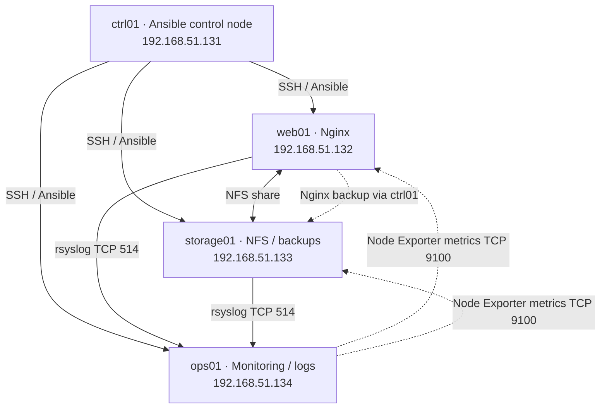

All addresses are **private lab IPs**; adapt them to your environment.

| Host | Role | Key technologies |
| --- | --- | --- |
| `ctrl01` | Automation controller | RHEL 9, Ansible, SSH keys |
| `web01` | Web and backup source | Nginx, systemd, NFS client |
| `storage01` | Shared storage and backup destination | NFS, LVM/XFS, ACLs, security updates |
| `ops01` | Operations and visibility | Prometheus/Grafana lab, centralized rsyslog |

## Implemented work

- **Ansible:** managed inventory, connectivity/health checks, and Nginx deployment.
- **Web:** installed/enabled Nginx and deployed a custom HTML landing page.
- **Storage:** configured shared NFS storage in the lab and tested access from `web01`.
- **Monitoring:** deployed Node Exporter on `web01` and `storage01`; configured rsyslog forwarding to `ops01`. Prometheus/Grafana work was performed on the VM, but its full configuration is not included in this archive.
- **Security:** practiced SSH hardening, least-privilege sudo, ACLs, SELinux contexts, firewalld, service auditing, and security patch management.
- **Backup/recovery:** created local Nginx configuration archives, tested restore, and transferred dated archives to `storage01` with Ansible using a dedicated `backupsvc` account.

## Repository structure

```text
nexaops-enterprise-linux/
├── README.md
├── .gitignore
├── inventory.ini
├── nginx.yml
├── system-check.yml
├── files/
│   └── index.html
├── monitoring/
│   ├── node-exporter.yml
│   └── rsyslog-clients.yml
├── backup/
│   └── remote-backup.yml
└── docs/
    ├── patch-management.md
    ├── backup-and-recovery.md
    └── screenshots.md
```

## Running the supplied playbooks

**Prerequisites:** Ansible installed on the controller; RHEL-based managed VMs; SSH key-based access; required privileges and packages. Replace the inventory addresses and key paths for your own lab. Do not commit private keys or credentials.

```bash
ansible all -i inventory.ini -m ping
ansible-playbook -i inventory.ini system-check.yml
ansible-playbook -i inventory.ini nginx.yml -K
ansible-playbook -i inventory.ini monitoring/node-exporter.yml -K
ansible-playbook -i inventory.ini monitoring/rsyslog-clients.yml -K
```

The monitoring playbooks assume supporting services and firewall policy are configured separately. The Nginx playbook does not itself open HTTP in firewalld.

### Remote backup

```bash
ansible-playbook -i inventory.ini backup/remote-backup.yml
```

This playbook **does not create the backup**. It fetches the current day's existing `nginx-YYYY-MM-DD.tar.gz` from `web01` to `/root/backup-transfer/` on `ctrl01`, then uploads it to `/data/backups/` on `storage01`. It expects the dedicated `backupsvc` account, SSH key `/root/.ssh/nexaops_backup`, and directory permissions to have been configured beforehand. It runs **on demand**; automated remote scheduling is not included in this repository. See [Backup & Recovery](docs/backup-and-recovery.md).

## Security notes

- The inventory contains only RFC1918/private lab addresses and a **path** to a private SSH key, not the key itself.
- The dedicated backup account can write to the backup destination; this is a convenience for the lab, **not immutable backup storage**.
- Review downloaded scripts, firewall rules, checksums, and host-specific settings before using these playbooks in another environment.
- Do not reuse the lab's credentials or addresses in production.

## Evidence and documentation

- [Security & Patch Management](docs/patch-management.md)
- [Backup & Recovery](docs/backup-and-recovery.md)
- [Screenshot checklist](docs/screenshots.md)

Selected screenshots are linked below. Review and sanitize any additional screenshots before publishing.

## Skills demonstrated

Linux administration · RHEL 9 · Bash · Ansible · SSH · Nginx · NFS · LVM/XFS · systemd · SELinux · firewalld · ACLs · rsyslog · Prometheus Node Exporter · backup and restore · troubleshooting

## Project screenshots

Selected evidence from the lab. Screenshots illustrate the tested environment; they are not substitutes for the full VM configuration.

### Ansible connectivity

Connectivity checks across managed hosts.

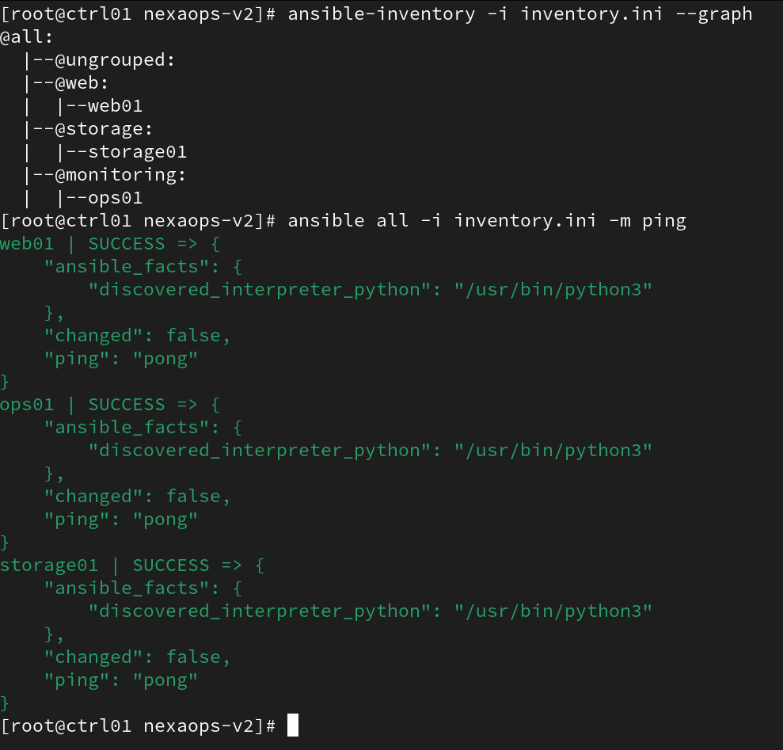

### Automated Nginx deployment

Ansible playbook deployment.

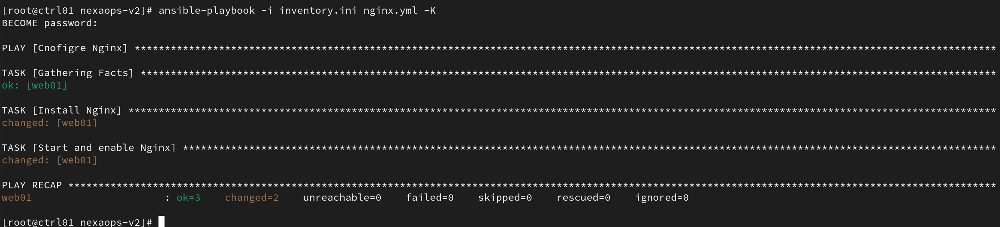

### Nginx landing page

Custom web page served from web01.

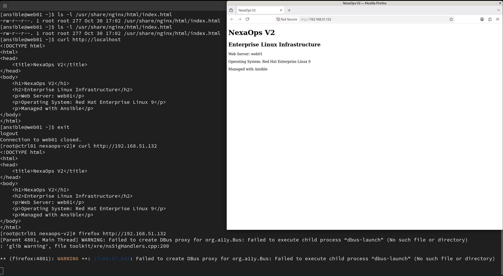

### LVM storage

Logical volume configuration.

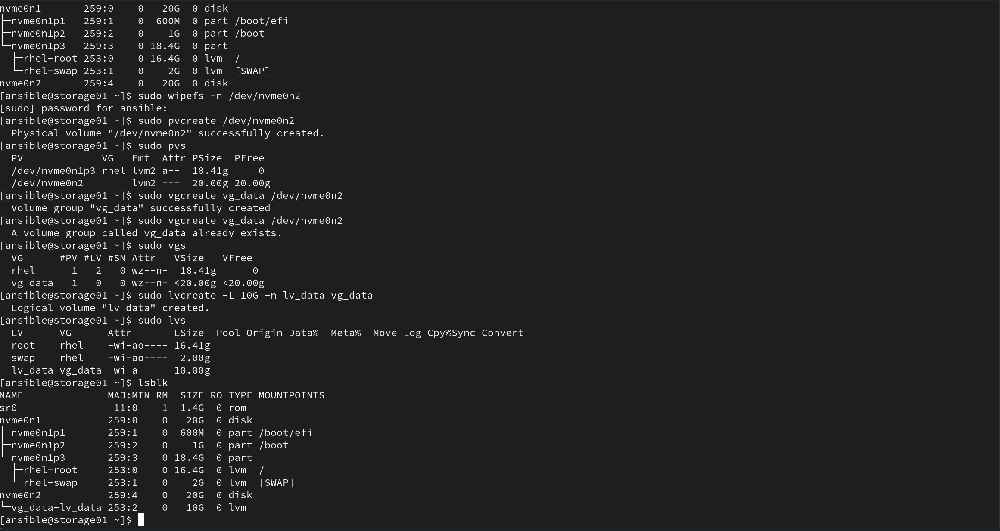

### NFS sharing

Cross-host file sharing validation.

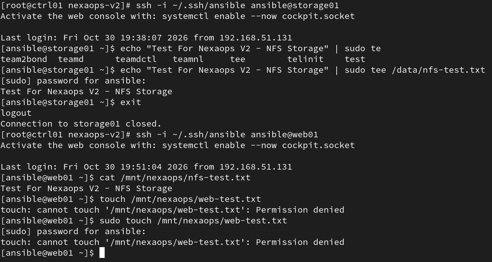

### Firewall security

Firewall configuration checks.

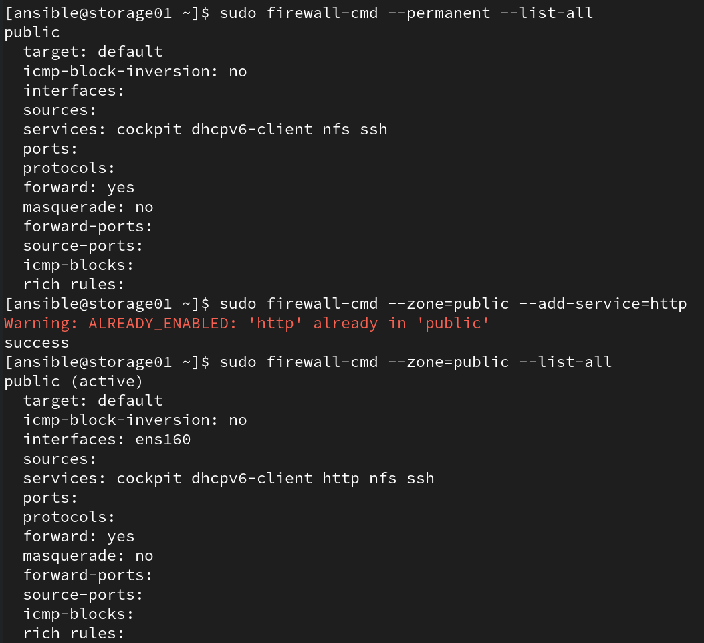

### Prometheus targets

Monitoring targets.

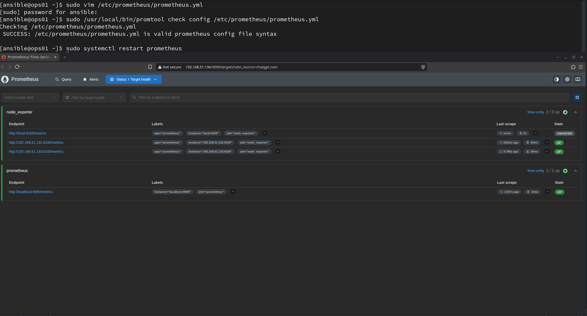

### Grafana dashboard

Linux metrics dashboard.

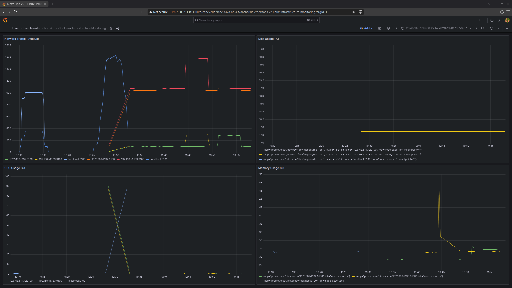

### Centralized logging

rsyslog collection.

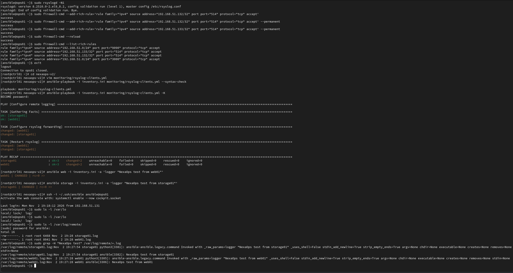

### Remote backup

Ansible backup transfer to storage01.

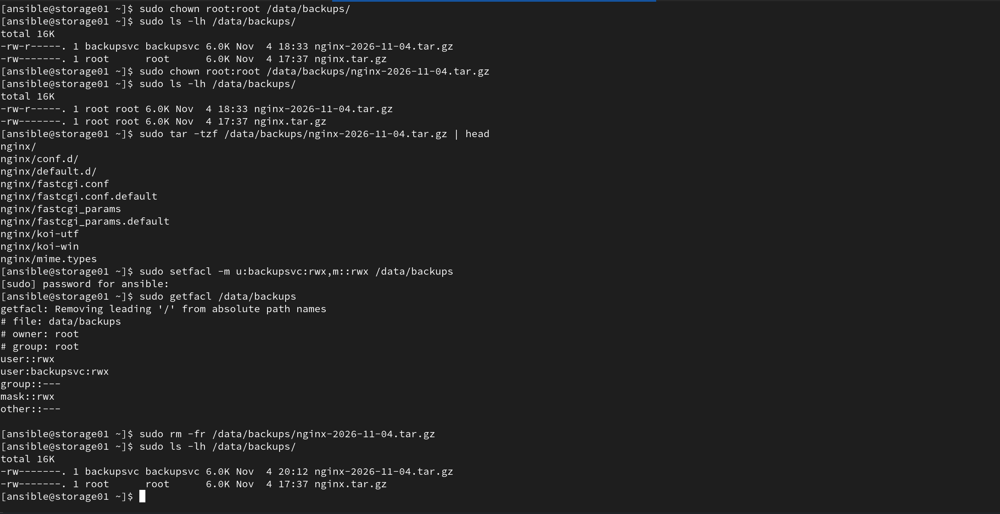

